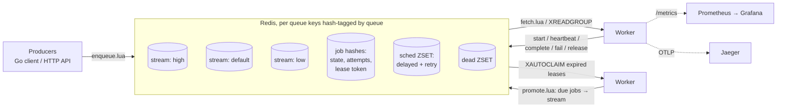

# taskq

A distributed task queue for Go, backed by Redis Streams. Delivery is
at-least-once with crash recovery, fenced leases, retries with jittered
backoff, a dead-letter queue, delayed jobs, priorities that can't starve,
rate limiting, backpressure and graceful shutdown. Every multi-step state
change is a single Lua script.

The emphasis is on behaviour under failure: worker processes are SIGKILLed,
Redis is restarted and failed over, and the network is degraded with
Toxiproxy. Each of those tests ends by checking that no acknowledged job was
lost and by counting duplicates. Every number in this README comes from a
recorded run that's saved in the repo.

- [`docs/DESIGN.md`](docs/DESIGN.md): delivery guarantees, data model, state machine, every Lua script and why it must be atomic, what Redis can lose
- [`docs/FAILURE_MODES.md`](docs/FAILURE_MODES.md): each failure, what happens, and the test that proves it

## Architecture



A job's lifecycle:

```
enqueue ──▶ pending ──start──▶ active ──complete──▶ succeeded
   │           ▲                 │ │ └──fail (attempts left)──▶ retry ──promote──┐
   │           │                 │ └──fail (exhausted / Permanent)──▶ dead ──replay─┤
   └─delay──▶ scheduled ─promote─┘   (reclaim: active ──start──▶ active, new token)│
               ▲                                                                   │
               └───────────────────────────────────────────────────────────────────┘
```

- **Streams deliver, hashes hold state.** A stream entry carries only the job ID.
  The job hash holds the payload, the state, the attempt count and the current lease token.
- **A lease is the PEL idle time.** Workers heartbeat with `XCLAIM … JUSTID`, but only
  after checking that they still own the entry. When a worker dies, its entries go idle,
  and after the visibility timeout another worker `XAUTOCLAIM`s them.
- **Fencing.** Each start rotates a random lease token. A stale worker's `complete`,
  `fail`, `release` or heartbeat is rejected and writes nothing.
- **A Go transition table is the single source of truth.** Each script receives its
  allowed source states from it, and an illegal transition is rejected without any write.

## Quickstart

Requirements: Go 1.27+, Docker.

```bash
make up          # Redis, API, 2 workers, Prometheus, Grafana (docker compose)

curl -s -X POST localhost:8080/v1/queues/default/jobs \
  -d '{"type":"demo","payload":{"sleep_ms":50},"priority":"high","idempotency_key":"order-42"}'
# {"id":"…","duplicate":false}

curl -s localhost:8080/v1/queues/default/jobs/<id>     # state, attempts, timings
curl -s localhost:8080/v1/queues/default/stats         # waiting / in-flight / scheduled / dead
curl -s 'localhost:8080/v1/queues/default/dead?limit=10'
curl -s -X POST localhost:8080/v1/queues/default/dead/<id>/replay

# Grafana dashboard "taskq": http://localhost:3000
make down
```

Tracing: `OTEL_EXPORTER_OTLP_ENDPOINT=http://jaeger:4318 docker compose -f
deploy/docker-compose.yml --profile tracing up -d --build`, then
http://localhost:16686.

As a library (`go get github.com/yousufmohi/tasq`):

```go
c := taskq.NewClient(rdb)
id, err := c.Enqueue(ctx, "emails", taskq.EnqueueOptions{
    Type: "welcome", Payload: body, Priority: taskq.PriorityHigh,
    Delay: time.Minute, IdempotencyKey: "welcome-" + userID,
})

w, _ := worker.New(rdb, worker.Options{Queue: "emails", Concurrency: 16}, func(ctx context.Context, j *taskq.Job) error {
    // At-least-once: pass j.IdempotencyKey() to the downstream so a re-run is harmless.
    return mailer.Send(ctx, j.Payload, j.IdempotencyKey())
})
_ = w.Run(ctx) // cancelling ctx drains in-flight jobs, then releases stragglers
```

Tests:

```bash
make test      # unit + integration against real Redis (testcontainers), -race
make failure   # SIGKILL / Redis restart / Toxiproxy / failover suite, -race; writes results/failure/*.json
bench/run.sh   # benchmark matrix; writes bench/results/<timestamp>/
```

## Guarantees

- **At-least-once execution of acknowledged enqueues**, as long as the write that created the
  job survives in Redis. Worker crashes, hangs and partitions never drop a job.
  A delivered job stays in the PEL until a worker settles it.
- **Every multi-step state change is atomic** (one Lua script), and illegal
  transitions are rejected with no partial writes.
- **Fenced leases:** a worker that lost its lease can't change the job's state.
- **Bounded crash loops:** a job that kills its worker every time is
  dead-lettered after `MaxAttempts` starts.
- **Every enqueue has an idempotency key** that is stable across every delivery
  (`Job.IdempotencyKey()`), plus enqueue deduplication by key.
- **Backpressure and rate limits are global per queue** and enforced atomically.

## Non-guarantees

- **Not exactly-once.** Duplicates happen when a worker crashes after its side
  effect but before acknowledging (D1), when a lease expires under a live handler
  (D2), when a failover loses an ack (D3), when a producer retries without a key (D4),
  and when a handler ignores shutdown cancellation (D5). `idem.Once` narrows these, and
  only a downstream that deduplicates by key closes them. Measured below.
- **Not more durable than Redis.** With asynchronous replication, a failover
  loses writes that weren't yet replicated, *including acknowledged enqueues*.
  `Durability{Replicas: 1}` (`WAIT`) and `min-replicas-to-write` narrow this,
  measured below. Neither is a consensus guarantee.
- **No ordering guarantee** beyond first delivery within one priority.
- **Not Redis Cluster-tested.** Keys are hash-tagged per queue, but only a single
  primary (with an optional replica) is tested.

## Measured results

Everything below was produced by commands in this repo. Raw data is
committed. Environment for both suites: AMD Ryzen 5 7600X (6 cores / 12
threads), 15 GiB RAM, WSL2 Ubuntu 22.04 on Windows 11, Go 1.27.3, Redis 7.4.12 in
Docker Desktop 29.7.2 (AOF `everysec`). Clients reach Redis through Docker
Desktop's port forwarding: PING round trip p50 0.17 ms, p99 0.246 ms (`env.json`). These
are single-machine numbers, not a production network.

### Failure tests (`make failure` at commit `f2c12c1` → `results/failure/`)

| Scenario | Acked | Lost | Dup. executions | Dup. naive effects | Dup. `idem.Once` effects |
|---|---|---|---|---|---|
| 10× SIGKILL of 4 worker processes mid-job | 401 | **0** | 46 | 0 | 0 |
| Silent 4 s partition of one worker (VT 1 s) | 60 | **0** | 8 | 8 | **0** |
| 50 ms ± 10 ms latency each way | 300 | **0** | 0 | 0 | 0 |
| Connection resets, 10 flaps | 400 | **0** | 1 | 1 | 0 |
| Redis graceful restart, AOF everysec | 7,978 | **0** | 2 | 2 | 0 |
| Redis SIGKILL, AOF always | 4,454 | **0** | 2 | 2 | 0 |
| Redis SIGKILL, AOF everysec | 8,119 | 0 (reported, not guaranteed) | 1 | 1 | 0 |
| Redis SIGKILL, no persistence (positive control) | 7,880 | 3,161 | – | – | – |
| Failover, async replication (demonstration) | 78,514 | 60,768 | – | – | – |
| Failover, `min-replicas-to-write 1` | 17,675 | 3 | – | – | – |
| Failover, `Durability{Replicas: 1}` | 10,440 | **0** (80 flagged uncertain) | – | – | – |

The idempotent downstream (a set keyed by idempotency key) applied every
executed job exactly once in every scenario. The positive control exists to
prove the harness *can* see loss. The failover rows are demonstrations of Redis
replication, not taskq guarantees. In an earlier recorded run (commit
`01c78da`), 8 enqueues that *returned errors* to the producer had in fact been
applied. That ambiguous outcome is why producer retries need idempotency keys.
Details and the test behind each row: [`docs/FAILURE_MODES.md`](docs/FAILURE_MODES.md).

### Benchmarks (`bench/run.sh 3` at commit `f2c12c1` → `bench/results/20261104T005248Z/`)

48 runs (16 configurations × 3 repetitions). Every enqueued job succeeded,
with 0 enqueue errors. Values are the median of the 3 repetitions, with min–max in
parentheses. All latencies come from Redis timestamps at **1 ms resolution**, so
"1" means "under 2 ms". Raw per-job timings are in `raw/*.csv.gz`, and the
environment (including the git SHA) is in `env.json`.

**Consume throughput** (drain a 20,000-job backlog; jobs/s):

| Worker processes × 16 slots | No-op handler | 5 ms handler |
|---|---|---|
| 1 | 7,984 (7,918–8,003) | 2,400 (2,393–2,406) |
| 2 | 9,794 (9,699–9,809) | 4,720 (4,715–4,751) |
| 4 | 10,515 (10,331–10,554) | 7,396 (7,027–7,457) |
| 8 | 11,249 (11,148–11,442) | 8,973 (8,610–9,153) |

With a 5 ms handler, throughput scales almost linearly from 1 to 2 workers
(1.97×), and then flattens towards the no-op ceiling. With a no-op handler,
a single Redis is the bottleneck from the start: every job costs two
script calls (start, complete) plus its share of a batched fetch, all on one
Redis thread, so more
workers add only 41% from 1 to 8. Going past this needs batching start/complete
or sharding queues across Redis instances (keys are already hash-tagged per queue).

**End-to-end latency** (enqueue → success, open-loop arrivals, 4 workers × 16, no-op handler):

| Offered jobs/s | Achieved | p50 ms | p95 ms | p99 ms | max ms | Producer p99 schedule lag ms |
|---|---|---|---|---|---|---|
| 500 | 500 | 1 | 1 | 1 | 2 | 1.1 |
| 2,000 | 2,000 | 1 | 1 | 1 (1–2) | 9 (9–10) | 1.1 |
| 5,000 | 5,000 | 1 | 2 | 4 | 14 (14–20) | 0.7 |

The producer sends on a fixed schedule and records how late it was. A ~1 ms
p99 lag means the latencies above don't hide coordinated omission.

**Recovery time** (SIGKILL one worker under 100 jobs/s of 200 ms jobs; kill →
last orphaned job finished; 0 jobs lost in every run):

| Workers | Visibility timeout | Orphaned jobs | Recovery ms |
|---|---|---|---|
| 4 | 2 s | 5 (5–6) | 2,360 (2,209–2,562) |
| 4 | 5 s | 5 | 5,421 (5,291–5,519) |
| 4 | 10 s | 5 | 10,700 (10,440–11,340) |
| 2 | 5 s | 10 (10–11) | 5,272 (5,272–6,282) |
| 8 | 5 s | 2 (2–3) | 5,230 (5,230–5,550) |

Recovery time tracks the visibility timeout, not the worker count. The timeout
is the knob: lower it for faster recovery, at the price of more false reclaims
(duplicates) during GC pauses and network blips. Measured overhead past the
timeout was 0.2–1.3 s (reclaim scan interval + the 200 ms job + jitter).

Reproduce everything: `make test && make failure && bench/run.sh 3`.

## Repository layout

```
taskq.go, errors.go     client: Enqueue, GetJob, Stats, DLQ ops, queue config, durability
worker/                 runtime: fetch, start, heartbeat/self-fencing, reclaim, promote, shutdown, metrics
idem/                   idem.Once side-effect guard
internal/scripts/*.lua  every multi-step state change (one script each), plus fetch.lua
internal/state          the transition table the scripts receive
internal/api            HTTP API;  cmd/taskq-api, cmd/taskq-worker, cmd/taskq-bench
test/integration        testcontainers tests (make test)
test/failure            SIGKILL / restart / Toxiproxy / failover tests (make failure)
bench/                  run.sh, hardware.sh, results/
deploy/                 docker-compose, redis.conf, Prometheus, Grafana dashboard
```
